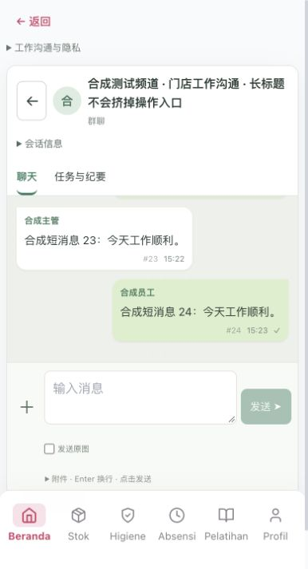
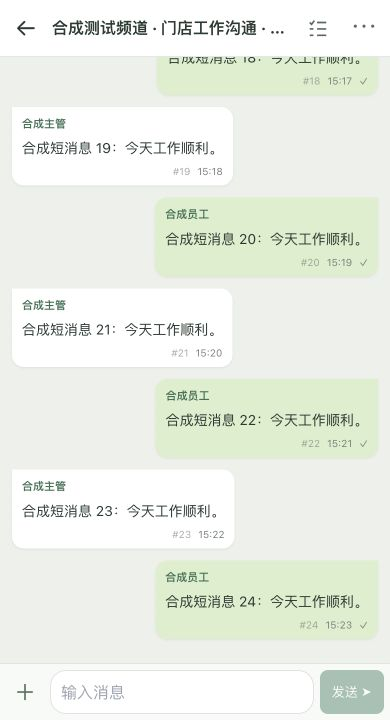

# 员工移动会话布局验收

基准：线上 `1d51c4b54f2e947d23847f48fb6720f0c01ad5b7`，保留 PR #254 的气泡、附件与照片压缩逻辑。远端 master 在验收时为 `a10d812e3dbc6fb4a5463fa50d58161be51723af`，与此线上基准的文件树相同。

原始用户截图 `IMG_9951.png` 已通过 Library materialize 到本机 `reference/IMG_9951.png`（相对于本任务工作区），确认存在并查看 947×2048 像素。原始截图包含会话资料，仅留本地，不加入 PR。以下截图全部为合成会话。

## 空间改善

实际浏览器 CSS 视口高度固定 720px，24 条同样的短消息，每个气泡包含作者、正文和时间。只计完整可见气泡，不计部分气泡；不把 Safari 外部工具栏计入网页视口。

| 宽度 | 修改前消息区 | 修改后消息区 | 视口占比 | 完整短消息 |
| --- | --- | --- | --- | --- |
| 375 | 210px | 606px | 29.2% → 84.2% | 2 → 6 |
| 390 | 210px | 606px | 29.2% → 84.2% | 2 → 6 |
| 430 | 210px | 606px | 29.2% → 84.2% | 2 → 6 |

消息区增加 396px（2.89 倍）。这组数值来自同一合成短消息夹具，不能解读为任意长度真实消息都能显示六条。原始截图中的长消息仍需自然换行。

## 注释与入口处理清单

| 原常驻内容 | 处理 | 理由 |
| --- | --- | --- |
| 站内返回 + 会话返回 | 会话内只留单个返回 | 返回列表后恢复全局导航 |
| 群头像、长标题、会话类型大卡 | 单行截断标题；完整内容入详情 | 控件始终可触达 |
| 工作沟通与隐私折叠行 | 收入同一个详情菜单 | 审计与权限告知仍可查询 |
| 会话信息折叠行、成员清单 | 标题栏详情菜单 | 不单独占一行高度 |
| 成员已读位置折叠行 | 同一详情菜单内 | 不把已读混同任务接收 |
| 聊天/任务纪要双 tab | 标题栏任务入口 | 任务、纪要、权限与人工验收信息保留 |
| 发送原图、图片优化说明 | 仅选中图片时出现原图选择 | 默认照片压缩保持原有实现 |
| 附件、Enter 换行、点击发送说明 | 从员工会话主界面删除 | 重复解释显然操作 |
| 附件大小/类型限制 | 选择器提示与详情可查，超限就地报错 | 必要限制在需要时提供 |
| 离线、发送失败、版本冲突 | 保留就地状态/错误提示 | 属于行动所需的信息 |
| 会议开始/结束 | 同一详情菜单内 | 功能仍在，不常驻输入框下方 |
| 首次引导 | 本批未新增 | 不制造另一个永久提示区域 |

交互资料参考 [Apple 信息官方说明](https://support.apple.com/guide/iphone/send-and-reply-to-messages-iph82fb73ba3/ios)：标题访问会话详情、底部输入与添加附件、返回会话列表。沿用本项目视觉与业务操作，没有照抄其界面或增减业务权限。

## 验证结果

- 375/390/430 宽：无横向溢出、无重复返回、标题截断，输入条保持可见。
- visualViewport 模拟：高 380px、offsetTop 45px 时，frame 顶部45/底部425，输入条底部425；消息区266px，即模拟可视区的70%。三种宽度均通过。关闭后恢复原高度及草稿。
- 模拟 34px 底部安全区：关闭键盘消息区572px；键盘打开时不重复保留底部安全区。
- 原生视口720→400→720：主动阅读旧消息时 scrollTop 保持0；回到最新入口恢复到末尾。
- 输入 1/3/12 行，高44/90/144px，达到上限后输入框内部滚动。
- 返回列表、浏览器后退/前进后恢复文字草稿和阅读位置；最终复测 scrollTop 1061→1061。已选合成图片与原图选择也按会话隔离保存。
- 长 URL/长消息换行；800×600 合成图片预览、放大/关闭、内容展开后继续跟随末尾均通过。主动向上阅读不会被图片或尺寸变化拉回末尾。
- 中、英、印尼语；768×900、1024×800；空会话、失败状态；任务/纪要入口和隐私菜单可查、Escape关闭均通过。
- 员工与后台 `build` 均通过，包含各自 TypeScript 检查；两端翻译检查通过，保留已有提示性警告。后台构建有现存大包警告，未扩大本批处理范围。
- 图片压缩/透明PNG/失败回退与私有附件缓存、身份切换、取消读取等相关回归：7/7 通过。

运行日志保留在同目录本地 `staff-build.log`、`admin-build.log`、`staff-i18n.log`、`admin-i18n.log`、`regression.log`。原始浏览器测量为 `before-metrics.json`、`after-metrics.json`、`browser-checks.json`。

## 范围与待发布验证

没有改 API、AI、权限、上传协议或业务数据，没有部署，没有向真实员工发消息或下载真实图片。与 AI 队列任务保持文件边界；不占用任何后台 AI 设置页、全局样式或共享 API。

草稿与阅读位置在当前打开的沟通页内按会话保存；刷新或离开该模块后释放，不新增私密草稿的持久化存储。

当前 Chrome 扩展禁止读取本机文件，原生文件选择仅尝试一次即停止；未更改权限或重复弹窗。原图选项的展示/草稿测试使用页面生成的图片，不能代替原生相册选图。实体 iPhone Safari、真实键盘/输入法、相册选择及上线后的真实页面验收仍待独立 review 后安排。本次仅交付草稿 PR。
